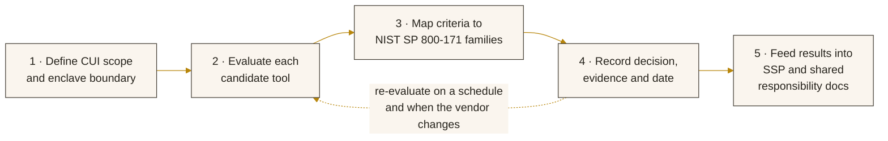

# 

  
  
  
  
  

Reference toolkit for building a CMMC Level 2 enclave on GCC High: tool evaluation framework and decision matrix mapped to NIST SP 800-171.

> [!IMPORTANT]
> This is **not legal, compliance, or assessment advice.** See the [disclaimer](#-disclaimer) before relying on any mapping.

## 🎯 Purpose

When you build an enclave to handle CUI in Microsoft GCC High (or alongside it), every tool you add (security, backup, monitoring, ticketing, collaboration) needs to be evaluated consistently. This toolkit gives you a vendor-neutral way to do that and to keep the evidence for your System Security Plan (SSP).

## 📦 Contents

| File | Use it for |
|---|---|
| [`tool-evaluation-template.md`](templates/tool-evaluation-template.md) | One copy per candidate tool |
| [`decision-matrix.md`](templates/decision-matrix.md) | Criteria mapped to NIST SP 800-171 control families |
| [`decision-matrix.csv`](templates/decision-matrix.csv) | Same matrix, spreadsheet-friendly |

## 🧭 How to use

1. Define your CUI scope and enclave boundary first (see the official CMMC Scoping Guide for Level 2).
2. Copy `templates/tool-evaluation-template.md` once per candidate tool and fill it in using the vendor's official documentation (FedRAMP marketplace, trust/compliance pages, shared responsibility matrix, contracts).
3. Use `templates/decision-matrix.md` (or the CSV) to see which evaluation criteria bear on which NIST SP 800-171 control families, so you know which questions matter for the tool's role.
4. Record the decision, the evidence you relied on, and the date. Re-evaluate on a schedule and when the vendor changes.
5. Feed the results into your SSP and shared responsibility documentation.

This toolkit contains **no vendor recommendations and no pricing**. Those decisions are yours.

## 🧾 Disclaimer

> [!WARNING]
> - This is **not legal, compliance, or assessment advice.**
> - The mappings are a **starting point written by the author**, not an official crosswalk. **Verify against NIST SP 800-171 Rev. 2 and the official CMMC documents** (CMMC Assessment Guide Level 2, CMMC Scoping Guide, 32 CFR Part 170, DFARS 252.204-7012) and consult your C3PAO or qualified advisor.

> [!CAUTION]
> **No CUI.** Do not put CUI, customer data, credentials, tenant identifiers, or non-public contract details in this repo or in filled-in copies you publish.

## 📄 License

MIT. See [LICENSE](LICENSE).

<!-- pizzazz-recipe: {"pz":1,"kit":"my-color-profile","concept":"Spec Sheet","family":"refined","dev":{"intensity":"standard","flourish":"amber dividers","structure":"slim header"},"sig":"amber rule dividers","pal":{"pri":"#27241D","sec":"#423D33","tint":"#FAF5EE","zeb":"#F7F3EC","mut":"#625B50","ftr":"#6B6358","hair":"#D9D1C4","acc":"#D9A21B","watch":"#B44D12"},"font":{"h":"system-ui","b":"system-ui"},"date":"2026-11-19"} -->
